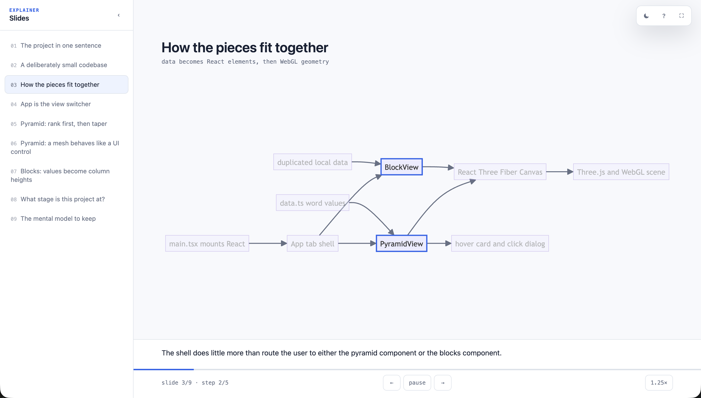

# explain-deck

An agent skill and CLI that turns an explanation into a narrated slide deck: one
self-contained HTML file that plays itself. It speaks a step, lights up the code
lines or diagram nodes that step is about, and advances when the audio ends.

Audio, syntax highlighting and diagrams are all inlined. The output is a single
file you can open over `file://`, email, or host. Speech is synthesised on your
machine; your code never leaves it.



## Install

```bash
npx -y explain-deck@latest init
```

That puts the skill into every coding agent it finds (Claude Code, Codex,
Cursor, Gemini CLI, GitHub Copilot, OpenCode, Windsurf, Amp). Restart the agent,
then ask it:

```
/explain how does the ingestion pipeline choose a parser?
```

`--agent claude-code,codex` limits the install to the agents you name.
`npx skills add vishalx360/explain-deck` also works.

**Requirement: Node 18+.** There is nothing else to install. The skill calls
`npx -y explain-deck@1 build`, which fetches the CLI, and the first build
downloads the speech model into `~/.cache/explain-deck`. After that, builds
run offline and only re-render clips whose narration changed.

## Speech

Both backends run the same model, [Kokoro-82M](https://huggingface.co/hexgrad/Kokoro-82M),
at full precision, and the build picks one for you:

| Backend | When it's used | Speed | First-run download |
|---|---|---|---|
| **MLX** (bf16) | Apple Silicon with [`uv`](https://docs.astral.sh/uv/) on PATH | ~17× realtime | Python environment plus a ~340 MB model, built by `uv run` from the header of `src/tts_mlx.py` |
| **ONNX** (fp32) | everywhere else | ~2.5× realtime | ~330 MB model |

The MLX dependencies are pinned in `src/tts_mlx.py` with `exclude-newer`, so an
upstream release can't change the voice under you. If the MLX worker fails to
start, the build says why and falls back to ONNX.

- `EXPLAIN_TTS=mlx` or `EXPLAIN_TTS=onnx` forces a backend.
- `EXPLAIN_PYTHON=/path/to/python` uses an existing Python that already has `mlx_audio`, instead of `uv`.

## CLI

```bash
explain-deck build path/to/deck.json            # -> path/to/<folder-name>.html
explain-deck build path/to/deck.json --folder   # multi-file form, for very long decks
explain-deck build path/to/deck.json --no-open
explain-deck init [--agent claude-code,codex]
```

See [skill/SKILL.md](skill/SKILL.md) for the deck format and the guidance the
agent follows.

## Player

`space` pause · arrow keys navigate · `[` `]` speed · `M` mute · `S` sidebar ·
`T` theme · `F` full screen · `?` help · click any slide in the sidebar.

Muting silences the clip without pausing it, so the deck keeps advancing at
narration pace. Mute, speed and theme are remembered per browser
(`setMuted` and friends in `src/player.html`).

### Look and feel

The light theme:

- **Surfaces:** white page, `#f6f6f6` side panel and bands.
- **Text:** `#212529`, with titles in a light 300 weight.
- **Accents:** deep blue `#0047ab`, mint `#e4fcf7` for the lit lines.
- **Cover:** a mint-to-white gradient, and the navy button gradient for Play.
- **Top edge:** a mint-blue-gold gradient as a stripe.
- **Diagrams:** light-blue nodes with deep-blue borders.

Creato Display is named first in the font stack but not embedded, because
artifacts may only load stylesheets from Google Fonts and it isn't there. It
shows where installed and falls back to the system sans elsewhere.

The colors live in `src/player.html` under `:root[data-theme="light"]`, plus the
"Brand typography" block. The dark theme is the original GitHub-dark palette.
The viewer's system setting picks the theme, and `T` toggles it.

## Layout

```
bin/explain-deck.mjs   CLI entry: build | init
src/build.mjs          deck.json -> HTML: validation, speech, mp3, inlining
src/tts_mlx.py         MLX speech worker; its header is its own install recipe
src/init.mjs           installs skill/SKILL.md into each agent's skills folder
src/player.html        the player template
skill/SKILL.md         what the agent reads
vendor/                highlight.js 11.9.0 and mermaid 10.9.1, inlined into decks
```

## Releasing

```bash
npm version minor && npm publish && git push --follow-tags
```

`SKILL.md` calls `explain-deck@1`. Keep the deck format backwards compatible
within a major version, or bump the major version and the pin together.

## License

MIT. Kokoro is Apache 2.0, highlight.js BSD-3-Clause, mermaid MIT.
